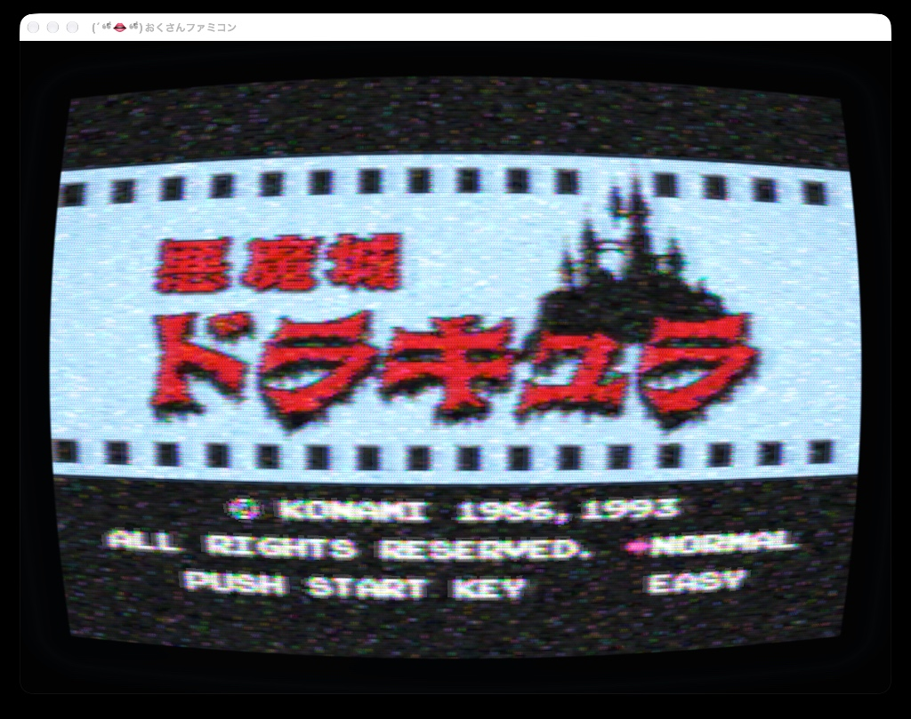
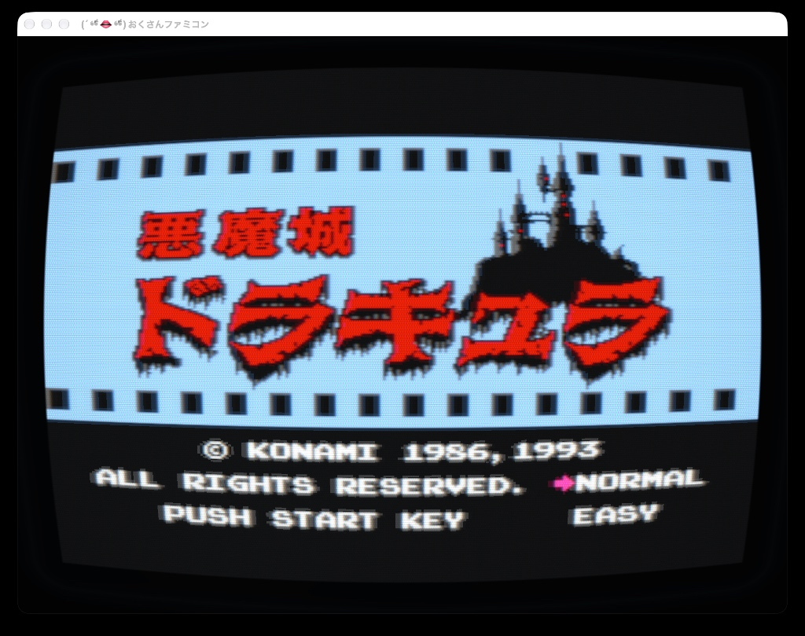
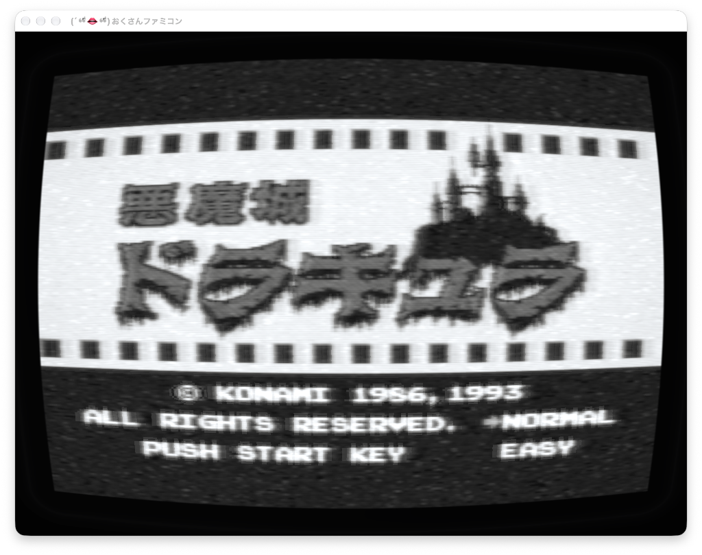
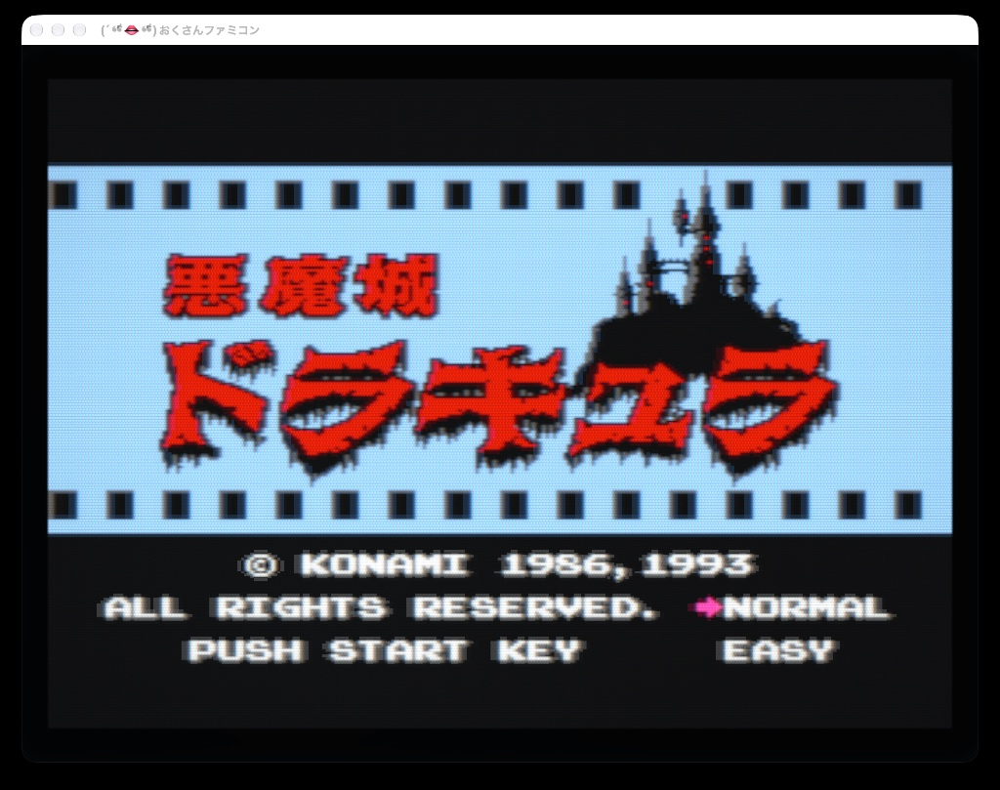
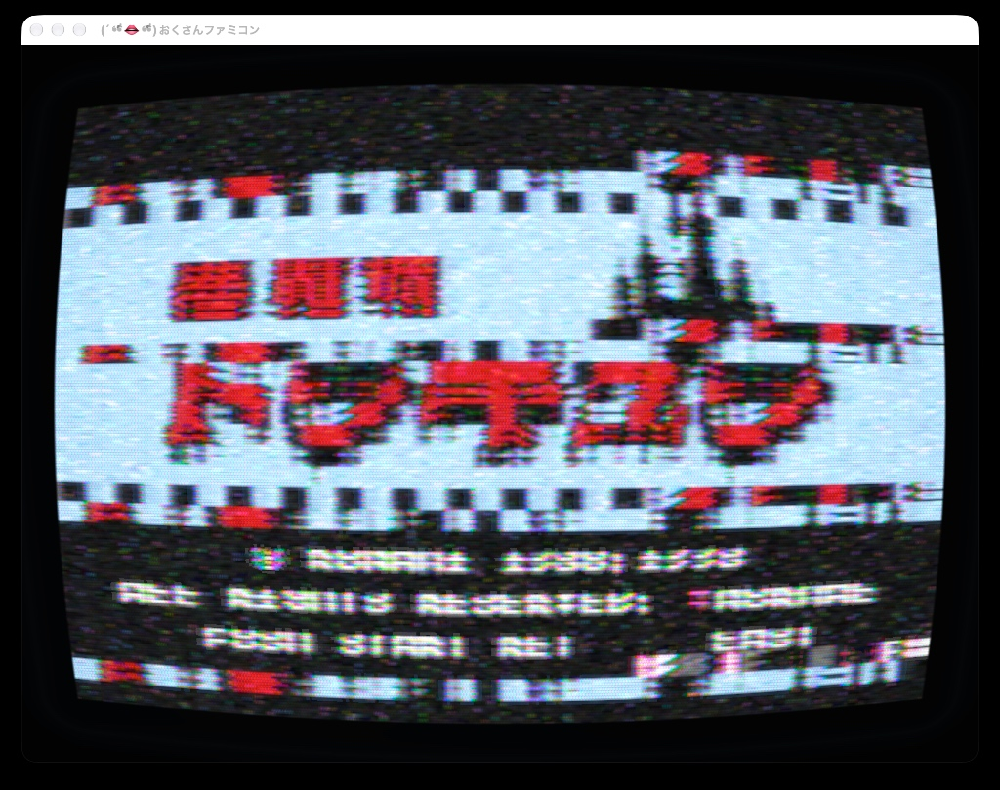
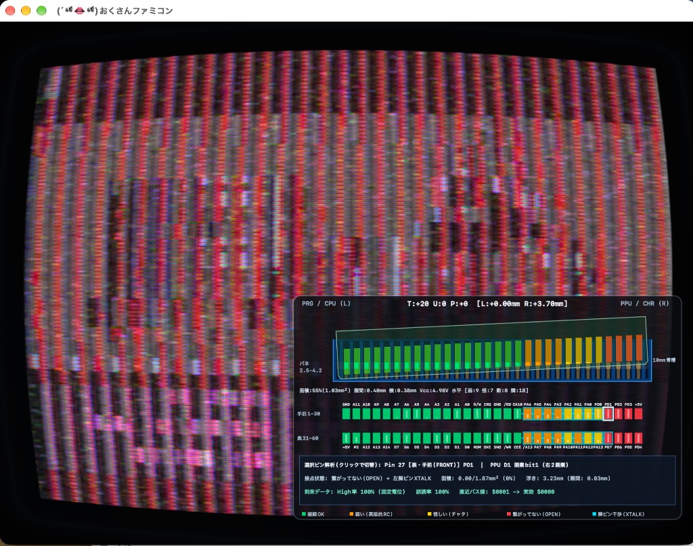

# おくさんファミコン (Okusan Famicom CRT) `v0.6`

[English](README.md) | **日本語 (Japanese)**

1980年代の家庭用 **14型ブラウン管テレビ**（VHF 300Ω RF 接続・小口径モノラルスピーカー・単一電子銃 白黒P4モード）と、ファミコンカセット60ピンの **「斜め差し接触不良」**、**ファミコン3Dシステム（HVC-031）表示モード**、および **ディスクシステム（HVC-022）ドライブ＆エラー再現** を統合した macOS 用ファミコン／NES プレイヤーです。

> **ROM データおよび FDS BIOS（`disksys.rom`）は一切同梱していません。**  
> ROM 未挿入で起動すると、昔のテレビにカセットを挿さずに電源を入れたときのような **無信号 RF 砂嵐待機** から始まります。`.nes` / `.fds` / BIOS ファイルをウィンドウへドラッグ＆ドロップするか `Cmd + O` で開くと、本体電源が入ります。

---

## スクリーンショット

| カラー RF テレビ (`Cmd + 2`) | RGB モニター (`Cmd + 1`) |
| :---: | :---: |
|  |  |
| **白黒 RF テレビ / P4 蛍光体 (`Cmd + 3`)** | **フラット RGB モニター (`Cmd + 1` + 曲率OFF `Cmd + C`)** |
|  |  |

| **接触不良コールドブート (`@`)** | **斜め差し `T:+20` ＋ 60ピン接点解析 HUD (`\`)** |
| :---: | :---: |
|  |  |

---

## 主な特徴と技術解説

### 1. 2-Pass Metal HDR/EDR ブラウン管パイプライン＆ VSync 同期（`src/video/`, `resources/shaders/`）

映像出力は `ExtendedLinearSRGB` 色空間の **Metal** `MTKView`（`MTLPixelFormatRGBA16Float`）上で [`okusan-crt.metal`](resources/shaders/okusan-crt.metal) を実行時コンパイルして描画します（参照用 GLSL も併存）。**Pass 0**（`beamloadFragment`）で現フレームと前フレームの Rec.601 輝度二乗値を `1×1 RGBA16Float` ターゲットへ縮小平滑化してカソードビーム負荷とフライバック高圧低下を推定し、続いて 3 種類の **Pass 1** シェーダのいずれかへ出力します。フレーム同期は `EmulationPacer`（`CADisplayLink` による 60 Hz 1:1 / 120 Hz ProMotion 1:2 ロック＋`NSActivityLatencyCritical` 指定）と `MacAudioEngine` 側の Dynamic Rate Control（DRC）により、スクロール時の引っかかりや音割れを抑えています。

- **HDR CRT ピーク強調（EDR / `Cmd + D`）＆実機準拠 ABL**
  - XDR / HDR ディスプレイ（`NSScreen.maximumExtendedDynamicRangeColorComponentValue > 1.0`）接続時、色域は昭和ブラウン管（sRGB / Rec.601 プライマリ）のまま変えずに、輝度ヘッドルームだけを拡張します。
  - Pass 0 の `beamLoad` に連動した **ABL（自動ビームリミッタ）** により、全白フラッシュ時は電源サグで控えめに抑えつつ、夜空の星・弾・文字・ハレーション・RF インパルスノイズなどの小面積ピークだけを EDR 領域へ鋭く発光させることで、走査線やスロットマスクによる光量低下を自然に補います（SDR 環境では 1:1 の従来出力へ自動フォールバック）。
- **RGB モニター**（`displayRgbFragment`, `Cmd + 1`）
  - くっきりした RGB 入力に対し、管面曲率・スロットマスク・480i 交互フィールド走査線／240p切替・微細な3電子銃コンバージェンスずれ・ガラス内面ハレーション・HV ブルームを適用します。
  - **ディスプレイ** メニューから **ブラウン管の湾曲 (オフで平面)**（`Cmd + C`）をオフにすることで **RGB フラット表示** も可能なほか、480i/240p（`Cmd + I`）・HDR ブラウン管ピーク強調（`Cmd + D`）・HV ブルーム（`Cmd + B`）・スロットマスク（`Cmd + K`）も個別に切り替えられます。
- **カラー RF テレビ**（`displayRfFragment`, `Cmd + 2`）
  - 走査線単位での NTSC YIQ コンポジット変調、300Ω 平行フィーダー線反射ゴースト（`-5 tap` / `-10 tap`）、復調前のガウシアン＋インパルス RF 砂嵐ノイズ、6タップ直交色副搬送波復調を物理ベースで計算し、色滲み・3.58 MHz クロスカラー・ドットクロール・P22 蛍光体残光を自然に発生させます。
- **白黒 RF テレビ / P4 蛍光体**（`displayBwFragment`, `Cmd + 3`）
  - シャドウマスク・3電子銃・I/Q 色復調を持たない **単一電子銃・銀白色 P4 蛍光体** モデルです。無濾波コンポジット検波により 3.58 MHz 色副搬送波がそのまま微細な白黒ドットクロールとして乗りつつ、RGB トライアドによるボケがないシャープな輪郭と強い HV ブルームを再現します（スロットマスク `Cmd + K` は自動無効化）。
- **CZ-612D 31kHz（X68000 RGB モニター）**（`displayX68k31kFragment`, `Cmd + 6`）
  - シャープ **CZ-612D / CZ-614D** 系の 31.5 kHz RGB マルチシンクモニターを物理再現しています。30 Hz インターレースちらつきのない **480本プログレッシブ倍線走査**（60 Hz 毎フレーム描画）、RGB サブピクセルがギラつかず滑らかな蛍光面質感になる **高密度デルタ配列（0.31 mm 相当）シャドウマスク**、ドットの輪郭をくっきり保つ水平・垂直フォーカス（`sigma = 0.25`）・極小コンバージェンス、濃色アンチグレア FST 管面曲率、ガラス内ハレーション、安定した高圧レギュレーション、および **約9300K の日本製ブラウン管色温度** を再現します。
- **未信号・通電断の砂嵐**
  - ROM 未挿入、本体電源 OFF（`O`）、または斜め差しでカートリッジ電圧が `Vcc < 3.40 V` に落ちると、RGB モードでは黒画面、RF モードでは湾曲走査線越しの RF 砂嵐を表示します。

### 2. 14型モノラル TV スピーカー & フリーズ DSP（`src/audio/TvSpeakerDsp.hpp`, `MacAudioEngine.mm`）

RF モード時は APU ステレオ出力をモノラル合成し、[`TvSpeakerDsp`](src/audio/TvSpeakerDsp.hpp) を通して再生します。

- **小口径紙コーンスピーカー EQ**: カスケード 580 Hz HPF（24 dB/oct で低音をカット）、740 Hz 中低域ディップ（`-4.5 dB`）、1650 Hz 小口径コーン共振ピーク（`+6.5 dB`）、カスケード 2850 Hz LPF、および `tanh(1.48x)` の小出力アンプ飽和を通します。
- **画面連動インターキャリアバズ**: 毎フレーム [`FrameLuminanceStats`](src/audio/TvSpeakerDsp.hpp) で画面を縦 16 帯域に分割し、輝度・白ピーク・彩度・水平エッジ量を解析して 59.94 Hz 垂直同期バズおよび `720 / 1080 / 1560 Hz` 高調波を変調。白い文字ウィンドウや高コントラスト画面でリアルに「ジーッ」と鳴ります。
- **無ポップゲート & クロスフェード**: 電源スイッチ（20 ms）・リセット長押し（8 ms）・RGB↔RF 切替（12 ms）を滑らかにフェードし、無信号時は `380 Hz〜6.2 kHz` の TV チューナーホワイトノイズへ切り替えます。
- **接触フリーズ（`F`）**: `F` を押すたびに 4 種類の実機風フリーズ（AMDF ピッチ固定「ピーッ」静止／2フレーム・マシンガンコマ切れ振動／`$2001` 色強調・毒色パレット化け／8×8 VRAM タイルゴミ散乱。起動直後の無音状態でも実機風バズを合成）からランダム発動し、再押下で正常に復帰します。
- **音声ピン減衰（Pin 45/46）**: `SND IN / SND OUT` の接触度に応じてゲーム音声を ~5 ms ランプで滑らかに減衰します。

### 3. HVC-001 60ピン物理斜め差し・接触不良起動＆実機バス連動（`third_party/fceumm/`, `src/hud/`）

改変済み `fceumm` コア内にファミコン実機コネクタの実寸ジオメトリ（ピッチ `2.54 mm`、基板幅 `78.00 mm`、金メッキ端子 `1.55 mm`、バネ接点 `1.10 mm`、青ソケット深さ `10.00 mm`、横遊び `±0.35 mm`、ピンごとの個体摩耗ばらつき）に加え、ピン単位の接触不良マスク（`okusan_set_pin_fault_masks`）を組み込んでいます。

- **3軸自由度（3-DOF）**: 左右傾き（`<` / `>`, `-32..+32`）、垂直引き抜き浮き（`Shift + <` / `>`, `0..+16`）、前後揺らし（`[` / `]`, `-8..+8`）、差し直し（`/` または `?`）。US / JIS 両キーボード配列の `@`・`[`・`]`・`\`・`¥` を自動判定します。
- **全 60 ピン接触不良起動＆電源 OFF スイッチ（`@`）**: 電源 ON 中に `@` を押すと本体電源 OFF として動作し、電源 OFF の状態で `@` を押すと **HVC-001 全 60 ピン（0–59）を対象** に、位置も本数もランダムな接触不良（単ピン酸化・2〜4 本の隣接クラスタ・表裏同番ペア・任意 3 軸傾き）を **電源投入前から適用** した状態でコールドブートし、右下に 60 ピン HUD を自動表示します（`/` で差し直し復旧）。
- **実機準拠の電気・バス挙動**:
  - **オームの法則によるブラウンアウト**: `GND1/GND2` と `+5V L/R` の並列合成接触抵抗から `Vcc` を計算し、`Vcc < 3.40 V` で通電断（砂嵐）、`3.40〜4.35 V` で低電圧アクセス遅延を発生。
  - **非対称 RC 遅延・CPU 稀発チャタリング・2.1 秒周期ドリフト**: `WEAK` 接触はプルアップ（`0→1`）を強く遅延させ、境界揺らぎを `frame_tick >> 7`（約 2.1 秒周期）に抑えることで、60 Hz の不自然な点滅を防ぎます。軽〜中度の CPU/PRG 酸化ピンは稀な遷移エッジでのみスリューエラーを起こすため、即黒画面にならずタイトル起動後の途中乱れ・暴走も自然に発生します。
  - **CPU・PPU 実機オープンバス＆8px 縦筋（ジェイルバー）**:
    - CPU `$4020–$FFFF` で `A0..A14`, `D0..D7`, `R/W`, `M2`, `/ROMSEL`, 外部 `/IRQ` をフック。`/ROMSEL` やデータバス断時はオープンバス (`X.DB`) を読み込み、実 6502 同様に不正命令でハングします（`/` 差し直し + `R` リセットで復帰）。
    - PPU は 2C02 のアドレス／データ多重化を再現し、`CHR` アドレス／`/RD` 断時は `vadr & 0xFF`、`PPU D0..D7` の個別断線時は一定電位プルアップ（`1`）により実機特有の **8px 周期のくっきりした縦筋（ジェイルバー）** を発生します。`CIRAM /CE`・`PPU /A13` の `WEAK`/`OPEN` 時は `off & 0xFF` のオープンバスを返します。
    - 故障姿勢から **`/`（`?`）** で一気に差し直した瞬間のみ、本体内 2 KB `CIRAM`（`NTARAM`）へ 1 ショットの誤ラッチが焼き付き、「正常に戻してもその画面の壊れた背景だけしばらく残る」実機特有の現象を再現します。
- **対話型 1:1 mm HUD（`\` キーまたはクリックで固定）**: 青ソケット断面・接点重なり・隙間・`Vcc`・`[弱/怪/断/隣]` 集計・全 60 ピンのリアルタイム High 率バーとシアン `XTALK` 線を表示し、任意のピンをクリックして `$orig -> 実効 $eff` バス値をライブ監視できます。
- 計算式・全 60 ピン詳細表：[`docs/60pin-hardware-notes.md`](docs/60pin-hardware-notes.md)（[English Spec](docs/60pin-hardware-notes.en.md)）

### 4. ファミコン 3D システム（HVC-031 / `$4016 OUT1`）

ゲーム側が `$4016` bit 1（`OUT1`）で左右眼シャッターを交互に駆動すると、`ppu.c` が走査線 120 付近（およびフレーム内パルス）で 3D 駆動を自動検出し、**ディスプレイ → ファミコン 3Dシステム (`G`)** サブメニューを有効化します。

- **裸眼 (生CRT 60Hz交互表示 / 既定値)**: 暗転やシャッター減光を入れず、生の 60 Hz CRT 映像のまま表示します。
- **3Dスコープ実機 (HVC-031 液晶+残像)**: TN 液晶シャッターの透過率低下（約 42%）と 30 Hz 交互駆動の明滅を再現します。
- **並行視 (SBS 最大65mm IPD制限)**: 左右の CRT 画面を並べ、裸眼並行視向けに瞳孔間距離（65 mm 相当上限）を抑えて配置します。
- **交差視 (SBS L/R反転)**: 交差視向けに左右画面を反転配置します（メニューから **左右 (L/R) 映像を入れ替える** の個別反転も可能）。

### 5. ディスクシステム（HVC-022 / ユーザー準備 BIOS）

- **BIOS 同梱なし（自動登録）**: 本アプリ・リポジトリには `disksys.rom` などの著作権保護された BIOS を一切同梱していません。ご自身で吸い出した正規 BIOS（8 KB / 16 KB / iNES ヘッダ付き、`*NINTENDO-HVC*` 検証済み）を `Cmd + O` やドラッグ＆ドロップで一度開くと BIOS スタンバイ起動と同時に `~/Library/Application Support/Okusan-Famicom-CRT-Player/disksys.rom` へ自動登録され、以降は `.fds` を直接開けます。
- **ドライブ操作＆差分セーブ**: BIOS スタンバイ中からの `.fds` ホットスワップ、裏返し（`C`）、抜き出し（`E`）、片面挿入（`1`〜`4`／メニューからは最大 8 面）、および元イメージを書き換えない XOR 差分セーブ（`fds_diff_<name>.ofds`）に対応します。
- **ランダム読込エラー再現（`T`）**: ディスク半挿し・電池低下・ボリューム/ブロックヘッダ異常・CRC エラーなど実機準拠の **ERR. 01〜28**（9 種類）をランダム発生させます（`R` リセットでエラー解除）。

---

## ビルド方法（macOS）

### 必要な環境

- **macOS 12.0 以降**（Apple Silicon `arm64` / Intel `x86_64` 両対応）
- **Xcode Command Line Tools**（`clang++`, `make`, `install_name_tool`, `codesign`）

未導入の場合は以下でインストールできます：

```bash
xcode-select --install
```

### ビルド手順

```bash
git clone https://github.com/eijis-okusan/okusan-famicom-crt.git
cd okusan-famicom-crt

# third_party/fceumm (fceumm_libretro.dylib) のコンパイルと .app 生成を一括実行
make

# そのままアプリを起動
make run
```

ビルド成果物は `build/Okusan Famicom CRT.app` に出力されます（コア動的ライブラリ、GLSL シェーダ、`AppIcon.icns`、`Info.plist`、`LICENSE.txt` を内包し、アドホック署名まで自動実行します）。

### Make ターゲット一覧

```bash
make core        # third_party/fceumm/fceumm_libretro.dylib のみビルド
make app         # コア（必要時）＋ macOS .app バンドルを生成
make ARCH=x86_64 # アーキテクチャを明示指定（既定は `uname -m`）
make clean       # build/ 以下のみ削除（fceumm の .o は残す）
make distclean   # build/ と third_party/fceumm の生成物を全削除
```

> **補足**: `Makefile` でローカル環境向けにアドホック署名（`codesign --force --deep --sign -`）を行います。他環境でビルド済みの `.app` を配布・起動した際に Gatekeeper の警告が出た場合は、右クリック → **開く** から起動するか、ソースから `make` でビルドしてください。

---

## 使い方・操作一覧

### ROM・ディスクの読み込みと履歴

- `.nes` / `.fds` / お手持ちの FDS BIOS（`.rom` / `.bin` / `.nes`）ファイルをウィンドウへドラッグ＆ドロップするか、**エミュレータ → ROM / .fds を開く...**（`Cmd + O`）、または CLI 第 1 引数にパスを渡して起動できます。
- 起動成功した ROM / ディスクは **直近 10 本** まで `NSUserDefaults`（`recentRoms`）に保存され、メニューバーの **履歴 / History** からワンクリックで起動できます（**履歴をクリア** で消去）。
- クイックセーブ（`F5`）／ロード（`F8`）および FDS 差分セーブデータ（`.ofds`）は以下に保存されます：  
  `~/Library/Application Support/Okusan-Famicom-CRT-Player/`

### キーボード＆カセット操作

| キー / ショートカット | 機能 |
| --- | --- |
| `↑↓←→` / `W A S D` | 十字キー（既定値。`Cmd + ,` でボタンごとに 3 枠まで変更可能） |
| `Z` / `K` / `Space` | A ボタン（既定値） |
| `X` / `J` | B ボタン（既定値） |
| `Return` / `Tab` / `RShift` | START / SELECT（既定値） |
| `<` / `>` | カセット左右傾き（`-32 .. +32`） |
| `Shift + <` / `Shift + >` | カセット垂直浮き（`0 .. +16`） |
| `[` / `]` | カセット前後揺らし（`-8 .. +8`） |
| `/` (`?`) | カセット差し直し（`0, 0, 0`） |
| `\`（または HUD クリック） | 60ピン接点 HUD の常時表示ピン留め切替（JIS の `¥` も可） |
| `O` | ファミコン本体電源 ON / OFF |
| `@` | 電源 ON 中はスイッチ OFF／OFF から押すと全60ピンランダム接触不良起動＋HUD表示 |
| `R`（単押し／長押し） | リセット（押している間は音声ミュート＆画面遮断。FDS エラー状態も解除） |
| `F` | 接触フリーズ ON / OFF |
| `G` | 3D システム表示モード切替（`裸眼 60Hz` → `3Dスコープ` → `並行視` → `交差視`） |
| `C` / `E` / `1–4` / `T` | FDS ディスク：裏返し / 抜く / 面挿入（1〜4） / ランダム読込エラー再現 |
| `P` | 一時停止 / 再開 |
| `F5` / `F8` | クイックセーブ / クイックロード |
| `Cmd + 1` / `2` / `3` / `6` | 15kHz RGB / カラー RF / 白黒 RF / CZ-612D 31kHz 切替 |
| `Cmd + 4` / `5` | プリセット：RGB + フラット / RF + 湾曲・ノイズ付き |
| `Cmd + D` | HDR CRT ピーク強調（EDR / ABL）ON / OFF |
| `Cmd + I` / `B` / `C` / `K` | 480i/240p・HV ブルーム・管面曲率・スロットマスク切替 |
| `Cmd + M` / `Cmd + F` | ミュート / フルスクリーン切替 |
| `Cmd + O` / `Cmd + ,` | ROM / .fds を開く / コントローラ設定ウィンドウ |

### ゲームパッド対応

Apple `GameController` フレームワーク対応パッド（Xbox / PlayStation / Switch Pro / MFi 等）を自動認識します：
- **十字キー / 左アナログスティック** → 十字キー（左スティック有効/無効は **コントローラ** メニューから切替可能）
- **B / X** → NES B、**A / Y** → NES A（**ゲームパッド A / B 入替** で反転可能）
- **Menu** → START、**Options / L1** → SELECT
- **L2** → クイックセーブ、**Select + R2** → クイックロード（コントローラ設定画面から無効化可能）

### 表示言語の切替（日本語 / English）

起動時は macOS のシステム言語設定に自動追従します。アプリメニュー左端の **言語**（**システムに合わせる / 日本語 / 英語**）から、アプリを終了せずにいつでも即時切り替えできます（英語表示時は **Language → Follow System / Japanese / English**）。

---

## アーキテクチャとリポジトリ構成

### モジュールと信号フロー

```text
  FCEUmm コア (third_party/fceumm/src/)
   ├─ x6502.c / ppu.c / pputile.h / input.c / fds.c  <── フック ──>  okusan_cart.c / okusan_cart.h
   │   (3軸幾何・Vcc降下・XTALK・$4016 3Dシャッター・HVC-022 FDS ドライブ＆ERR.01〜28故障)
   ▼ (256x240 映像 / 48 kHz APU PCM / 60ピン・3D・FDS 状態)
  ポータブル C++17 コア層（Cocoa / Metal / CoreAudio 非依存）
   ├─ common/                  (FamicomTypes, DynamicLibrary Win32/POSIX ローダ, FdsBiosCache)
   ├─ core/                    (FamicomCore & CartridgeFaultInjector: libretro / 60ピン / 3D / FDS API)
   ├─ audio/                   (AudioPipeline & TvSpeakerDsp: リングバッファ・DRC・AMDF フリーズ合成)
   └─ video/                   (CrtLayoutMath & FreezeFrameGenerator: 4:3/SBS計算・RF電源/砂嵐曲線)
   ▼
  macOS UI・描画・音声バックエンド層 (src/{app,audio,video,hud,input}/*.mm)
   ├─ AppDelegate + AppMenuController + AppPreferences + EmulationPacer + FdsDriveController + LicensesWindow + AppLocalization
   ├─ CrtScreenView + CrtMetalPipeline + StatusBanner + Metal シェーダ (`okusan-crt.metal`, RGBA16Float EDR)
   ├─ CartConnectorHud         (1:1 mm ソケット断面図＆ライブピン監視)
   ├─ MacAudioEngine           (AudioPipeline へ繋ぐ薄い CoreAudio AudioUnit ドライバ)
   └─ InputBindings + InputPoller + ControllerSettingsWindow (キーボード ＋ GameController)
```

### ディレクトリ構成

```text
.
├── .github/workflows/
│   └── macos-build.yml             # GitHub Actions による macOS ビルド＆署名検証 CI
├── docs/
│   ├── images/                     # 画面モード・60ピンHUD スクリーンショット
│   ├── 60pin-hardware-notes.md     # 60ピン物理・CPU/PPU バス連動仕様書（日本語）
│   └── 60pin-hardware-notes.en.md  # 同仕様書（English）
├── resources/
│   ├── shaders/                    # Metal 2-pass HDR/EDR シェーダ (`okusan-crt.metal`) ＋ 参照用 GLSL ソース
│   ├── en.lproj/ & ja.lproj/       # ローカライズ済みアプリ名 (`InfoPlist.strings`)
│   ├── AppIcon.icns                # macOS アプリアイコン
│   └── Info.plist                  # バンドル情報（v0.6）
├── src/
│   ├── common/                     # 純粋 C++17 共通型 (`FamicomTypes.hpp`)、`DynamicLibrary.hpp`、`FdsBiosCache.{hpp,cpp}`
│   ├── core/                       # `FamicomCore` & `CartridgeFaultInjector`（純粋 C++17 の libretro/60ピン/3D/FDS API）
│   ├── audio/                      # `AudioPipeline.{hpp,cpp}` & `TvSpeakerDsp.hpp`（純粋 C++17）＋ 薄い `MacAudioEngine` (CoreAudio)
│   ├── video/                      # `CrtLayoutMath.{hpp,cpp}` & `FreezeFrameGenerator.{hpp,cpp}`（純粋 C++17）＋ Metal 描画層
│   ├── hud/                        # `CartConnectorHud`（CoreGraphics 1:1 mm コネクタ＆解析UI）
│   ├── input/                      # `InputBindings`, `InputPoller`, `ControllerSettingsWindow`
│   └── app/                        # `main`, `AppDelegate`, `AppMenuController`, `AppPreferences`, `EmulationPacer`, `FdsDriveController`, `LicensesWindow`, `AppLocalization`
├── third_party/
│   └── fceumm/                     # 60ピン物理・3Dシャッター・FDS・CPU/PPU フックを組み込んだ FCEUmm コア
├── LICENSE                         # GNU General Public License v2.0
├── Makefile
├── README.md
└── README.ja.md
```

**今後のマルチプラットフォーム拡張について**：純粋 C++17 のコア層（`src/common/`、`src/core/`、`src/audio/AudioPipeline.{hpp,cpp}`、`src/audio/TvSpeakerDsp.hpp`、`src/video/CrtLayoutMath.{hpp,cpp}`、`src/video/FreezeFrameGenerator.{hpp,cpp}`）および `resources/shaders/`、`third_party/fceumm/` は Apple 固有ヘッダを一切含まないため、Windows / Linux 版フロントエンド（SDL2 + Vulkan / Direct3D / OpenGL 等）を追加する際もそのまま共有できます。

---

## オープンソースソフトウェア・ライセンス

本リポジトリは改変版の **[libretro-fceumm](https://github.com/libretro/libretro-fceumm)** を統合しており、全体として **GNU General Public License v2.0**（[`LICENSE`](LICENSE)）の下で公開します。

- **FCEUmm (libretro)** — FCE Ultra / FCEU-mm ベースの NES/ファミコンエミュレーションコア（Xodnizel, CaH4e3, BERO, libretro contributors / GNU GPL v2.0。`src/okusan_cart.h`, `src/okusan_cart.c`, `Makefile.common`, `src/ppu.c`, `src/ppu.h`, `src/pputile.h`, `src/x6502.c`, `src/fceu.c`, `src/fds.c`, `src/fds.h`, `src/input.c` を拡張）
- **libretro API & libretro-common** — `third_party/fceumm` に内包（MIT License）
- **nes_ntsc**（Shay Green / Blargg）・**EMU2413**（Mitsutaka Okazaki）— `third_party/fceumm` に内包

アプリ内のメニュー **おくさんファミコンについて** および **オープンソースライセンス...** からも利用 OSS 一覧と GPL v2.0 ライセンス全文を確認できます。
