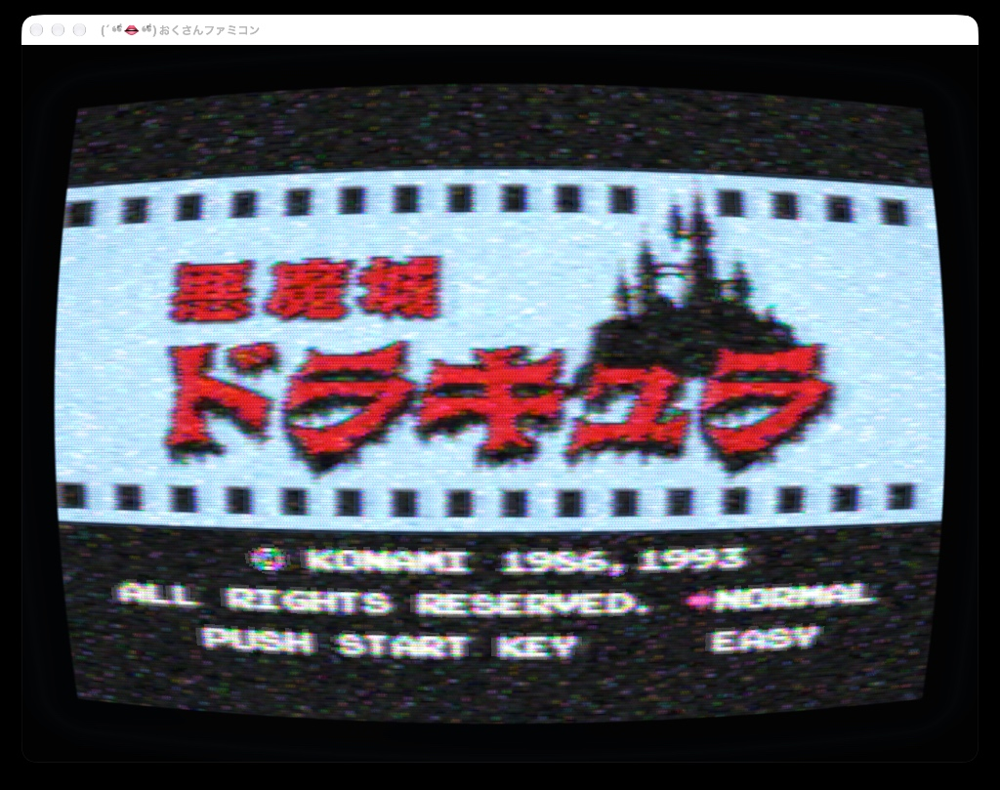
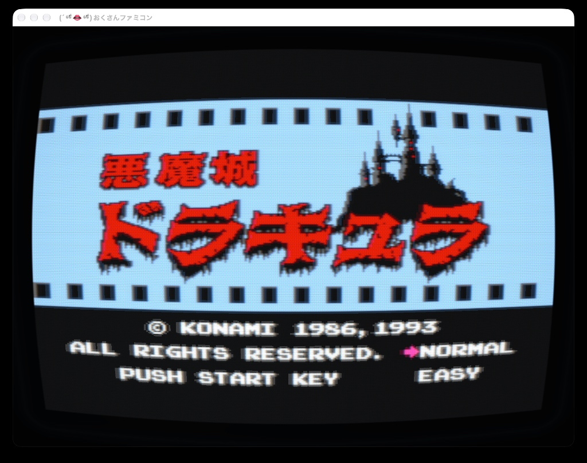
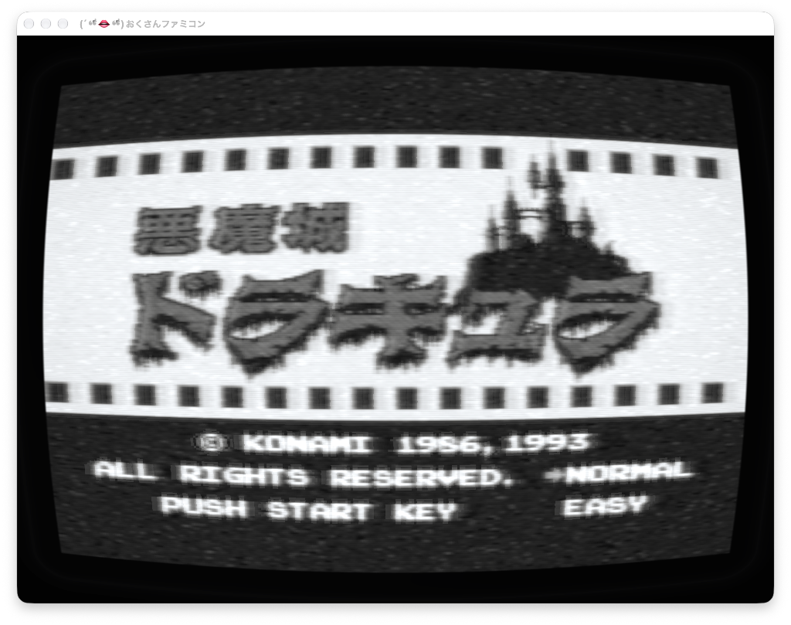
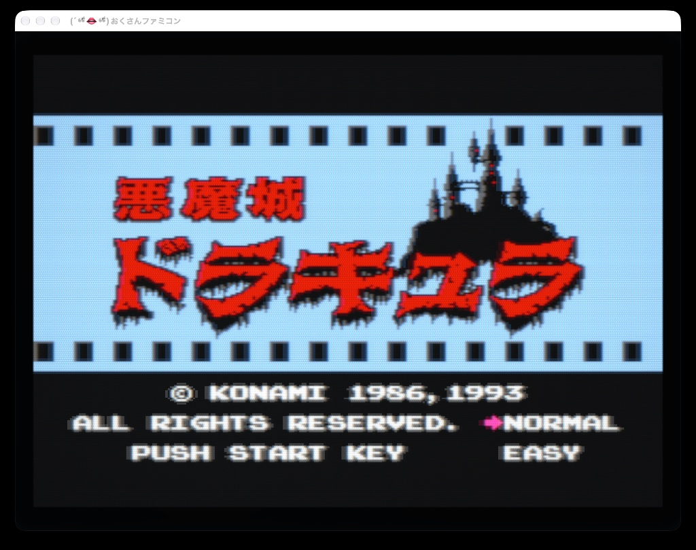
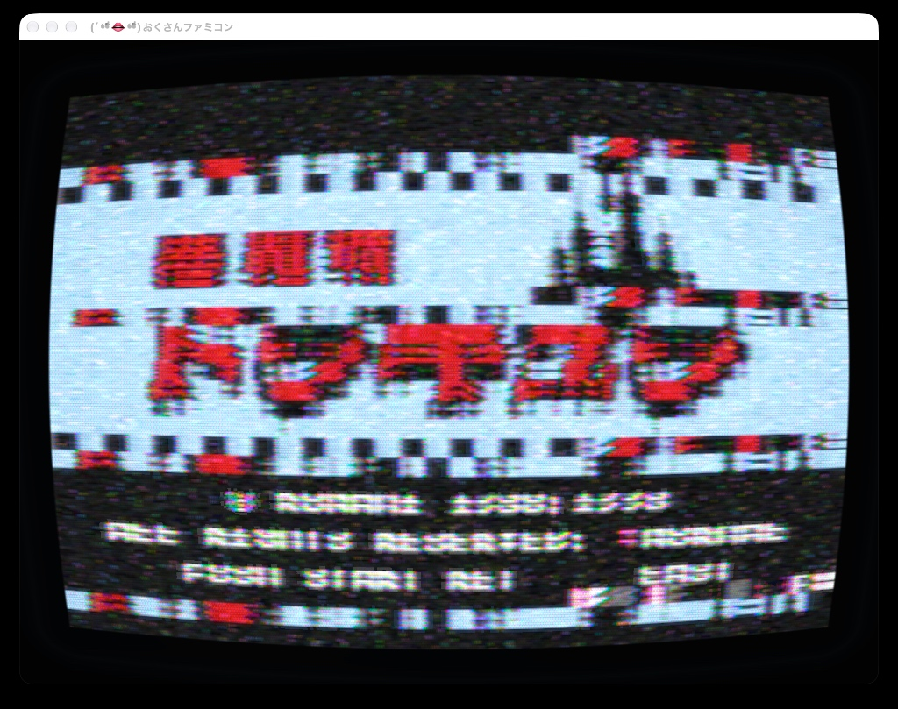
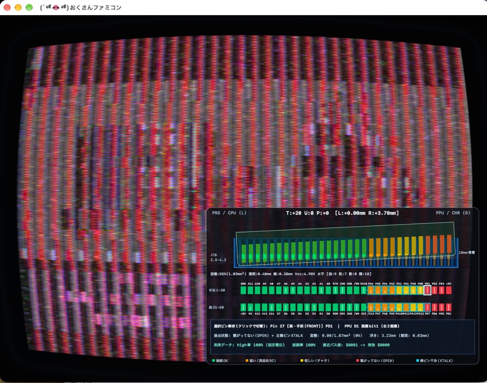

# Okusan Famicom CRT (おくさんファミコン) `v0.6`

**English** | [日本語 (Japanese)](README.ja.md)

A standalone Famicom / NES player for macOS that pairs a **1980s 14-inch CRT television simulation** (300-ohm VHF RF signal, single-gun B&W P4 phosphor mode, cheap plastic-cabinet monaural speaker DSP) with a **physical & electrical simulator of tilted 60-pin Famicom cartridge contacts**, **Famicom 3D System (HVC-031) shutter / stereoscopic views**, and **Famicom Disk System (HVC-022)** disk drive & fault emulation.

> **No ROMs or FDS BIOS files (`disksys.rom`) are included.**  
> Launching the app without a cartridge powers the television on into open-tuner **RF snow standby**—just like turning on an old CRT TV before inserting a cassette. Drag and drop any `.nes` / `.fds` / BIOS file onto the window or press `Cmd + O` to insert it and power on the console.

---

## Screenshots

| Color RF Television (`Cmd + 2`) | RGB Monitor (`Cmd + 1`) |
| :---: | :---: |
|  |  |
| **B&W RF Television / P4 Phosphor (`Cmd + 3`)** | **Flat RGB Monitor (`Cmd + 1`, Curvature Off `Cmd + C`)** |
|  |  |

| **Contact-Fault Cold Boot (`@`)** | **Tilted Cartridge `T:+20` + 60-Pin Inspector HUD (`\`)** |
| :---: | :---: |
|  |  |

---

## Key Features & Technical Architecture

### 1. Two-Pass Metal HDR/EDR CRT Display & VSync Pipeline (`src/video/`, `resources/shaders/`)

Video rendering runs on a **Metal** `MTKView` (`MTLPixelFormatRGBA16Float` in `ExtendedLinearSRGB`) compiled at runtime from [`okusan-crt.metal`](resources/shaders/okusan-crt.metal) (with GLSL reference shaders retained alongside). **Pass 0** (`beamloadFragment`) downsamples squared Rec.601 luminance across the current and previous frames into a `1×1 RGBA16Float` target (fed from a 4-slot texture ring) to estimate cathode beam load and flyback high-voltage sag, followed by one of three **Pass 1** display shaders. Frame cadence is driven by `EmulationPacer` (`CADisplayLink` locked 1:1 on 60 Hz / 1:2 on 120 Hz ProMotion displays with an `NSActivityLatencyCritical` assertion) paired with smooth Dynamic Rate Control (`MacAudioEngine`) for tear- and stutter-free scrolling:

- **HDR / EDR CRT Luminance & Physical ABL (`Cmd + D`)**
  - On HDR / XDR displays (`NSScreen.maximumExtendedDynamicRangeColorComponentValue > 1.0`), `CrtScreenView` unlocks macOS Extended Dynamic Range luminance within standard Rec.601/sRGB phosphor primaries (without distorting vintage colors into wide gamut).
  - Using Pass 0's `beamLoad`, an **Automatic Beam Limiter (ABL)** model expands localized highlights, scanline cores, phosphor slot peaks, glass halation, and RF impulse static into EDR headroom while gently sagging full-screen white flashes—compensating for scanline/slot-mask light loss and falling back seamlessly to 1:1 SDR on non-HDR displays.
- **RGB Monitor** (`displayRgbFragment`, `Cmd + 1`)
  - Clean RGB signal with barrel tube curvature, aperture slot mask, NTSC 480i alternating-field interlace or 240p scanlines, subtle RGB gun convergence offset, glass halation, and HV bloom.
  - Under the **CRT Display** menu, you can also flatten the tube (`Tube Curvature (Off = Flat)`, `Cmd + C`) and toggle scanline interlace (`Cmd + I`), HDR luminance (`Cmd + D`), HV bloom (`Cmd + B`), or slot mask (`Cmd + K`) to dial in a razor-sharp **flat RGB CRT** look.
- **Color RF Television** (`displayRfFragment`, `Cmd + 2`)
  - Models NTSC YIQ composite encoding along each scanline, 300-ohm twin-lead reflection ghosts (`-5 tap` and `-10 tap`), pre-demodulation Gaussian + impulse RF snow noise, and 6-tap orthogonal subcarrier demodulation—naturally producing chroma bleed, 3.58 MHz cross-color shimmer on fine patterns, dot crawl, and P22 phosphor decay.
- **B&W RF Television** (`displayBwFragment`, `Cmd + 3`)
  - Single-electron-gun **P4 silver-white phosphor** CRT with zero RGB triads, zero convergence error, and zero chroma decoder. Unfiltered composite video detection beats the 3.58 MHz chroma subcarrier directly into luminance as authentic monochrome dot crawl while keeping luminance edges crisp. Slot mask (`Cmd + K`) is automatically disabled in this mode.
- **X68000 Monitor (31.5kHz RGB)** (`displayX68k31kFragment`, `Cmd + 6`)
  - Physically models Sharp's **CZ-612D / CZ-614D** 31.5 kHz multisync PC/AV monitor: 480-line progressive line-doubled raster (every 60 Hz frame, zero 30 Hz interlace shimmer), hexagonal **delta dot-trio** (`0.31 mm` style) circular phosphor shadow mask, tight `sigma = 0.44` horizontal gun focus, dark-tinted FST low-curvature glass, regulated flyback HV, minimal glass scatter, and ~9300K Japanese workstation CRT white balance.
- **Standby & Brownout RF Snow**
  - When no ROM is loaded, the Famicom power switch (`O`) is off, or tilted cartridge resistance drops rail `Vcc < 3.40 V`, RGB mode cuts to black while RF modes display animated white-noise static on the curved 480i raster.

### 2. 14-Inch Monaural TV Speaker & Freeze DSP (`src/audio/TvSpeakerDsp.hpp`, `MacAudioEngine.mm`)

In RF modes, stereo APU output is summed to mono and routed through [`TvSpeakerDsp`](src/audio/TvSpeakerDsp.hpp):

- **Small Paper-Cone Speaker EQ**: Cascaded 2nd-order 580 Hz HPFs (24 dB/oct bass rolloff), a 740 Hz midrange scoop (`-4.5 dB`), a 1650 Hz narrow cone resonance (`+6.5 dB`), cascaded 2850 Hz LPFs, and soft `tanh(1.48x)` speaker/amp saturation.
- **Screen-Modulated Intercarrier Buzz**: Every frame [`FrameLuminanceStats`](src/audio/TvSpeakerDsp.hpp) samples luma, white peaks, chroma, and horizontal edges across 16 vertical screen bands to modulate 59.94 Hz vertical-sync buzz and `720 / 1080 / 1560 Hz` intercarrier harmonics—bright white text or flashes audibly buzz the speaker.
- **De-Clicked Gates & Crossfades**: 20 ms power gate, 8 ms reset mute gate, 12 ms RGB↔RF crossfade, and open-tuner white noise (`380 Hz–6.2 kHz`) when unpowered.
- **Cartridge Contact Freeze (`F`)**: Pressing `F` randomly triggers one of four classic hardware crash styles—clean AMDF pitch-locked tone, rapid 2-frame machine-gun stutter, `$2001` color-emphasis / palette inversion, or scattered 8×8 VRAM tile garbage (including synthesized pulse/square buzz fallback if triggered immediately after boot)—and pressing `F` again cleanly resumes gameplay.
- **Cartridge Audio Pins (`Pin 45/46`)**: `SND IN / SND OUT` contact area smoothly attenuates game audio over a ~5 ms ramp when tilting the cartridge.

### 3. HVC-001 60-Pin Cartridge Tilt, Faulty Cold Boot & Bus Simulator (`third_party/fceumm/`, `src/hud/`)

The modified `fceumm` core embeds an exact micrometer-scale physical model of the 60-pin Famicom cartridge slot (`2.54 mm` pitch, `78.00 mm` PCB width, `1.55 mm` gold fingers, `1.10 mm` console spring wipers, `10.00 mm` blue socket depth, `±0.35 mm` lateral play, per-pin wear variance) plus explicit per-pin fault masks (`okusan_set_pin_fault_masks`).

- **3-DOF Controls**: Lateral tilt (`<` / `>`, `-32..+32`), vertical pull-up lift (`Shift + <` / `>`, `0..+16`), front/back pitch (`[` / `]`, `-8..+8`), and instant reseat (`/` or `?`)—with both US ANSI and Japanese JIS key layout detection for `@`, `[`, `]`, `\`, and `¥`.
- **60-Pin Contact-Fault Cold Boot & Power Switch (`@`)**: When the console is ON, `@` powers it OFF cleanly (clearing tilt/masks). Pressing `@` while OFF injects randomized pre-boot contact faults—varying freely in both **pin position and count** across all 60 pins (`0..59`), mixing single oxidized pins, 2–4 pin adjacent clusters, front/back slot pairs, and optional 3-DOF skew—*before* power-on and pops open the 60-pin HUD automatically.
- **Hardware-Accurate Faults**:
  - **Ohm's Law `Vcc` Brownout**: Parallel contact resistance across `GND1/GND2` and `+5V L/R` drops cartridge rail voltage under load (`Vcc < 3.40 V` triggers power loss and RF snow; `3.40–4.35 V` introduces access-delay glitches).
  - **Asymmetric RC Delay, Sparse CPU Chatter & Slow Drift**: `WEAK` contacts delay `0→1` pull-up transitions more strongly than `1→0` pull-downs, with boundary drift locked to a ~2.1 s period (`frame_tick >> 7`) so screen corruption stays stable rather than flickering unnaturally at 60 Hz. Light/medium oxidized PRG/CPU lines glitch sparsely on rare transitions so games boot past the reset vector and crash organically mid-boot instead of always dying black on frame 0.
  - **Real CPU/PPU Open Bus & 8px Vertical Jailbars**:
    - CPU `$4020–$FFFF` hooks route `A0..A14`, `D0..D7`, `R/W`, `M2`, `/ROMSEL`, and external `/IRQ`; floating `/ROMSEL` or `CPU D0..D7` feeds open-bus (`X.DB`) until the 6502 jams on an illegal opcode (`Reset` + `Reseat` to recover).
    - PPU reads model the 2C02 multiplexed bus (`vadr & 0xFF` on CHR address/control open-bus, steady CMOS/NMOS `1` pull-up on isolated open `PPU D0..D7` lines to produce authentic **8px-periodic vertical jailbars**, `off & 0xFF` on weak/open `CIRAM /CE` or `PPU /A13` nametable reads, plus `CIRAM A10` mirroring faults).
    - Snapping a faulted cartridge back with **`/` (`?`)** latches a one-shot spurious write into internal 2 KB `CIRAM` (`NTARAM`), leaving background tile corruption on the current screen until scrolled away, changed, or reset (`R`).
- **Interactive 1:1 mm HUD (`\` or click)**: Visualizes the blue socket cross-section, spring-to-pad overlap, air gaps, `Vcc`, `[W/M/O/X]` totals, all 60 pin tiles with live HIGH duty bars and cyan `XTALK` links, and a clickable per-pin live bus inspector (`$orig -> $eff`).
- Full mathematical & hardware specification: [`docs/60pin-hardware-notes.en.md`](docs/60pin-hardware-notes.en.md) ([日本語版仕様書](docs/60pin-hardware-notes.md))

### 4. Famicom 3D System (`HVC-031`, `$4016 OUT1`)

When a game drives alternating left/right stereoscopic shutter frames via `$4016` bit 1 (`OUT1`), `ppu.c` detects the active 3D shutter cadence at scanline 120 (with per-frame pulse fallback) and unlocks the **CRT Display → Famicom 3D System (`G`)** submenu:

- **Raw 60Hz CRT (Default)**: Displays the unshuttered raw 60 Hz CRT feed so naked-eye titles and alternating fields remain crisp without dimming.
- **3D Scope (`HVC-031`)**: Simulates the TN-LCD polarizer dimming (~42% transmittance) and 30 Hz alternating shutter modulation.
- **Parallel SBS (`65mm IPD Cap`)**: Places left and right CRT tubes side by side with human interpupillary spacing capped for comfortable free-viewing.
- **Cross-Eyed SBS (`R | L`)**: Swaps viewport placement for cross-eyed stereoscopic viewing, plus an independent **Swap Left / Right Eyes** toggle.

### 5. Famicom Disk System (`HVC-022`, User-Supplied BIOS)

- **Bring Your Own BIOS (`disksys.rom`)**: No copyrighted Nintendo BIOS is bundled with the app or repository. Opening your own legal 8 KB / 16 KB / iNES-wrapped FDS BIOS (`*NINTENDO-HVC*` verified) via `Cmd + O` or drag-and-drop boots directly into FDS BIOS standby and automatically registers it at `~/Library/Application Support/Okusan-Famicom-CRT-Player/disksys.rom` for future `.fds` launches.
- **Physical Disk Drive Controls**: Supports hot-swapping `.fds` images onto live BIOS standby, flipping sides (`C`), ejecting (`E`), inserting sides 1–4 (`1`–`4`, up to 8 sides via menu), and non-destructive per-disk XOR write persistence (`fds_diff_<name>.ofds`).
- **Random FDS Read / Hardware Faults (`T`)**: Injects authentic FDS disk errors across `ERR. 01` (half-inserted), `ERR. 02` (low battery), `ERR. 21–25` (volume/block header ID errors), `ERR. 27` (CRC error), and `ERR. 28` (premature end); press `R` to clear faults and reset.

---

## Build & Installation (macOS)

### Prerequisites

- **macOS 12.0 or later** (Apple Silicon `arm64` or Intel `x86_64`)
- **Xcode Command Line Tools** (`clang++`, `make`, `install_name_tool`, `codesign`)

If you do not have the Command Line Tools installed yet:

```bash
xcode-select --install
```

### Build Steps

```bash
git clone https://github.com/eijis-okusan/okusan-famicom-crt.git
cd okusan-famicom-crt

# Build both third_party/fceumm (fceumm_libretro.dylib) and the macOS app bundle
make

# Launch the built app directly
make run
```

Build outputs are placed under `build/`:
- `build/Okusan Famicom CRT.app` (bundles `fceumm_libretro.dylib`, GLSL shaders, `AppIcon.icns`, `Info.plist`, and `LICENSE.txt`, ad-hoc code signed)

### Useful Make Targets

```bash
make core        # Build only third_party/fceumm/fceumm_libretro.dylib
make app         # Build core (if needed) + macOS .app bundle
make ARCH=x86_64 # Force target architecture explicitly (defaults to `uname -m`)
make clean       # Remove build/ artifacts (keeps compiled fceumm objects)
make distclean   # Remove build/ and clean third_party/fceumm objects
```

> **Note on running locally built binaries**: The `Makefile` applies an ad-hoc signature (`codesign --force --deep --sign -`). If you move a prebuilt `.app` downloaded from somewhere else and macOS Gatekeeper warns about an unidentified developer, right-click the app and choose **Open** (or build directly from source with `make`).

---

## Usage & Controls

### Loading ROMs, FDS Images & History

- Drop any `.nes`, `.fds`, or user-supplied FDS BIOS (`.rom` / `.bin` / `.nes`) file onto the window, choose **Emulator → Open ROM / FDS...** (`Cmd + O`), or pass a path as the first CLI argument.
- Up to **10 recently played ROMs** are saved in `NSUserDefaults` (`recentRoms`) and accessible under **History** (`履歴`) in the menu bar. Choose **Clear History** to reset the list.
- Quick Save (`F5`) / Quick Load (`F8`) files and FDS disk XOR save diffs are stored in:
  `~/Library/Application Support/Okusan-Famicom-CRT-Player/`

### Keyboard & Cartridge Shortcuts

| Key / Shortcut | Action |
| --- | --- |
| `Arrow Keys` / `W A S D` | D-Pad (default; 3 slots per button configurable via `Cmd + ,`) |
| `Z` / `K` / `Space` | A Button (default) |
| `X` / `J` | B Button (default) |
| `Return` / `Tab` / `RShift` | START / SELECT (default) |
| `<` / `>` | Tilt cartridge left / right (`-32 .. +32`) |
| `Shift + <` / `Shift + >` | Lift cartridge up / down (`0 .. +16`) |
| `[` / `]` | Rock cartridge front / back (`-8 .. +8`) |
| `/` (`?`) | Reseat cartridge flat (`0, 0, 0`) |
| `\` (or click HUD) | Pin / unpin the 60-pin connector HUD (`\` or `¥` on JIS) |
| `O` | Toggle Famicom console power (cold boot on power-on) |
| `@` | When ON: power OFF; when OFF: cold-boot with random 60-pin faults + HUD |
| `R` (press or hold) | Reset console (mutes audio & clears picture while held; clears FDS fault) |
| `F` | Toggle contact freeze (latches audio pitch loop + screen bump) |
| `G` | Cycle 3D System display mode (`Raw 60Hz CRT` → `3D Scope` → `Parallel` → `Cross`) |
| `C` / `E` / `1–4` / `T` | FDS Disk: Flip side / Eject / Insert Side 1–4 / Inject random read error |
| `P` | Pause / resume emulation |
| `F5` / `F8` | Quick Save / Quick Load |
| `Cmd + 1` / `2` / `3` / `6` | 15kHz RGB / Color RF / B&W RF / X68000 31.5kHz RGB Monitor |
| `Cmd + 4` / `5` | Preset: RGB + Flat / Preset: RF + Curved & Noise |
| `Cmd + D` | Toggle HDR CRT Luminance / Physical ABL (EDR) |
| `Cmd + I` / `B` / `C` / `K` | Toggle 480i/240p / HV Bloom / Curvature / Slot Mask |
| `Cmd + M` / `Cmd + F` | Mute Audio / Toggle Full Screen |
| `Cmd + O` / `Cmd + ,` | Open ROM / FDS... / Controller Settings Window |

### Gamepad Support

Any controller supported by Apple `GameController` (Xbox, PlayStation, Switch Pro, MFi) is auto-detected:
- **D-Pad / Left Analog Stick** → D-Pad (Left Stick toggleable in **Controller** menu)
- **B / X** → NES B, **A / Y** → NES A (swappable via **Swap Gamepad A / B**)
- **Menu** → START, **Options / L1** → SELECT
- **L2** → Quick Save, **Select + R2** → Quick Load (can be disabled in Controller Settings)

### Language Switching (Japanese / English)

The UI automatically matches your macOS system language on launch, and can be switched live at any time from the application menu (**Language → Follow System / Japanese / English**; in Japanese mode: **言語 → システムに合わせる / 日本語 / 英語**).

---

## Repository Layout & Architecture

### Signal & Module Flow

```text
  FCEUmm Core (third_party/fceumm/src/)
   ├─ x6502.c / ppu.c / pputile.h / input.c / fds.c  <── Hooks ──>  okusan_cart.c / okusan_cart.h
   │   (3-DOF geometry, Vcc, XTALK, $4016 3D shutter, HVC-022 FDS drive & ERR.01..28 faults)
   ▼ (256x240 video, 48 kHz APU PCM, 60-pin / 3D / FDS telemetry)
  Portable C++17 Engine Layer (Zero Cocoa / Metal / CoreAudio deps)
   ├─ common/                  (FamicomTypes, DynamicLibrary Win32/POSIX loader, FdsBiosCache)
   ├─ core/                    (FamicomCore & CartridgeFaultInjector: libretro, 60-pin, 3D, FDS API)
   ├─ audio/                   (AudioPipeline & TvSpeakerDsp: ring buffer, DRC, AMDF freeze synthesis)
   └─ video/                   (CrtLayoutMath & FreezeFrameGenerator: 4:3/SBS viewports, RF standby curve)
   ▼
  macOS Presentation Layer (src/{app,audio,video,hud,input}/*.mm)
   ├─ AppDelegate + AppMenuController + AppPreferences + EmulationPacer + FdsDriveController + LicensesWindow + AppLocalization
   ├─ CrtScreenView + CrtMetalPipeline + StatusBanner + Metal Shaders (`okusan-crt.metal`, RGBA16Float EDR)
   ├─ CartConnectorHud         (1:1 mm socket cutaway & live pin bus inspector)
   ├─ MacAudioEngine           (thin CoreAudio AudioUnit driver backed by AudioPipeline)
   └─ InputBindings + InputPoller + ControllerSettingsWindow (keyboard + GameController)
```

### Directory Tree

```text
.
├── .github/workflows/
│   └── macos-build.yml             # CI build + codesign verification on macos-14
├── docs/
│   ├── images/                     # Display mode & 60-pin HUD screenshots
│   ├── 60pin-hardware-notes.en.md  # Detailed 60-pin physical & bus spec (English)
│   └── 60pin-hardware-notes.md     # Detailed 60-pin physical & bus spec (Japanese)
├── resources/
│   ├── shaders/                    # Metal 2-pass HDR/EDR shader (`okusan-crt.metal`) + GLSL reference sources
│   ├── en.lproj/ & ja.lproj/       # Localized InfoPlist strings (`CFBundleName` / `CFBundleDisplayName`)
│   ├── AppIcon.icns                # macOS app icon
│   └── Info.plist                  # Bundle metadata (v0.6)
├── src/
│   ├── common/                     # Pure C++17 shared types (`FamicomTypes.hpp`), `DynamicLibrary.hpp`, `FdsBiosCache.{hpp,cpp}`
│   ├── core/                       # `FamicomCore` & `CartridgeFaultInjector` (pure C++17 libretro/60-pin/3D/FDS API)
│   ├── audio/                      # `AudioPipeline.{hpp,cpp}` & `TvSpeakerDsp.hpp` (pure C++17) + thin `MacAudioEngine` (CoreAudio)
│   ├── video/                      # `CrtLayoutMath.{hpp,cpp}` & `FreezeFrameGenerator.{hpp,cpp}` (pure C++17) + Metal view/pipeline
│   ├── hud/                        # `CartConnectorHud` (CoreGraphics 1:1 mm connector & inspector)
│   ├── input/                      # `InputBindings`, `InputPoller`, `ControllerSettingsWindow`
│   └── app/                        # `main`, `AppDelegate`, `AppMenuController`, `AppPreferences`, `EmulationPacer`, `FdsDriveController`, `LicensesWindow`, `AppLocalization`
├── third_party/
│   └── fceumm/                     # Modified libretro-fceumm core source (okusan_cart.c/.h, 3D shutter, FDS, CPU/PPU hooks)
├── LICENSE                         # GNU General Public License v2.0
├── Makefile
├── README.md
└── README.ja.md
```

**Cross-platform note**: All pure C++17 core modules (`src/common/`, `src/core/`, `src/audio/AudioPipeline.{hpp,cpp}`, `src/audio/TvSpeakerDsp.hpp`, `src/video/CrtLayoutMath.{hpp,cpp}`, `src/video/FreezeFrameGenerator.{hpp,cpp}`), `resources/shaders/`, and `third_party/fceumm/` compile without any Cocoa/Apple dependencies, ready for Windows/Linux frontends (e.g., SDL2 + Vulkan/D3D/OpenGL).

---

## Open Source Software & License

This repository incorporates a modified version of **[libretro-fceumm](https://github.com/libretro/libretro-fceumm)** and is licensed under the **GNU General Public License v2.0** (see [`LICENSE`](LICENSE)).

- **FCEUmm (libretro)** — NES/Famicom core based on FCE Ultra / FCEU-mm by Xodnizel, CaH4e3, BERO, and libretro contributors (GNU GPL v2.0; extended with `src/okusan_cart.h`, `src/okusan_cart.c`, `Makefile.common`, `src/ppu.c`, `src/ppu.h`, `src/pputile.h`, `src/x6502.c`, `src/fceu.c`, `src/fds.c`, `src/fds.h`, and `src/input.c`)
- **libretro API & libretro-common** — Bundled inside `third_party/fceumm` (MIT License)
- **nes_ntsc** (Shay Green / Blargg) & **EMU2413** (Mitsutaka Okazaki) — Bundled inside `third_party/fceumm`

In-app acknowledgments and the full license text are available under **Okusan Famicom CRT → About Okusan Famicom CRT** and **Open Source Licenses...**.
